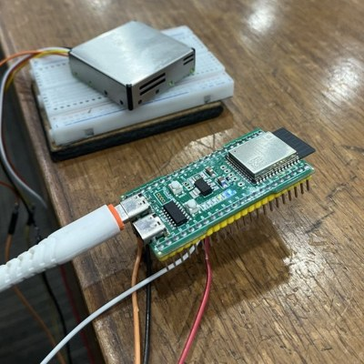

# The Vayu Project

**One clear answer for the air at the places you care about.**

It is 8 am, the morning after Diwali, in Delhi. The city app says "bad". A parent still has to decide: do we walk to school?

The Vayu Project answers for _one place_. Home, near R K Puram: **US AQI 500** (the top of that scale), from the Lodhi Road monitor **3.8 km** away, as recorded (the recording uses four Delhi monitors; the live app chooses from about 7,000). The air at this monitor is **in the GRAP Stage IV band** (our estimate; the official order that morning was Stage II for all of NCR, from a city average of 351, and this one monitor was far above it). Stay in; if you must go out, 4 to 5 pm is the cleanest hour (known only in hindsight, because this is a recorded day).

Live: **https://d3lmq1mze2gup3.cloudfront.net** (a phone or a laptop; create an account to save your places, or **Try without login** to see the recorded days) · See it on seven real past days: **https://d3lmq1mze2gup3.cloudfront.net/#/week**


## Why it is different

- **One answer for one place.** A card for Home, a school, a park: which monitor the number came from, how far away it is, how old the reading is, and what to do (walk, mask, windows, whether assembly should be inside).
- **It says when not to trust itself.** A reading older than six hours gives no advice. A regional-model number is labelled an Estimate. A GRAP stage is shown as our estimate.
- **Code decides, AI only words.** Fixed rules decide the advice. The model may reword it, and every number in its wording is checked against the facts, or the plain text goes out.
- **It reaches into your room.** A small measuring unit (an ESP32-S3 and a laser particle sensor, over Bluetooth) puts your room's air beside the air outside.

Built with Claude as a coding assistant.

## Try it in two minutes

1. Open the live address. Add a place (search, or "Detect my location"): its card shows the AQI, the weather, the nearest monitor's name, distance and age, and today and the next two days. With no places yet, **See the recorded days** opens the seven real past days in a new tab.
2. Open the card: **Insights for this place** (a school's morning assembly, a walk in a park, alerts that apply there).
3. Open the **Map** (every monitor, wind, fires), **Exposure** (the air a person breathed, hour by hour) and **AIR Lens** (the air as particles in front of the camera).
4. Press the round **Ask** button and ask "When can I walk today?" in English or हिन्दी.
5. Step through the seven recorded days at `/#/week`: 7 Oct 2025 (rain, and the cleanest of the seven), 21 Oct (the day after Diwali: the Stage IV band at Home's monitor; the official order was Stage II), 31 Oct (stubble fires), 9 Nov (smog, Stage III), 22 Dec (smog, Stage II), 23 Jan 2026 (heavy rain clears the smog overnight) and 30 Mar (wind).
6. With a measuring unit: **Add device** at the top right of My Air, then Connect over Bluetooth (Chrome on a computer or Android; not iPhone Safari). See [`docs/UNIT.md`](docs/UNIT.md).

## What it does

| Screen                |                                                                                                                                                                                                                                     |
| --------------------- | ----------------------------------------------------------------------------------------------------------------------------------------------------------------------------------------------------------------------------------- |
| **My Air**            | Alerts for the next three days (GRAP stages, smog, stubble burning, rain, wind) and small tasks for today, then your cards: **Your room** (when a unit is added), then your places, each in the colour of its air.                  |
| **Your room**         | The unit's live reading against the air outside at your place, the gap between them, a test that marks "purifier on" or "window opened" and shows how far the air moved, the room's day by hour, and a few plain insights.          |
| **Exposure**          | A 24-hour dial of the air a person breathed: at home, at work or school, and outdoors. Add the people in a family, with school or work hours. Log outdoor time. Hours the unit measured replace the outside reading at the address. |
| **Map**               | Every monitor the app can read, wind, fires, and the colour between. Advice is given only for Delhi and north India.                                                                                                                |
| **AIR Lens**          | Point a phone camera and see the air as particles, with a scene for each place; an eye button makes the card see-through.                                                                                                           |
| **Assistant**         | Ask a question or tell it something ("Asha walked in the park for 40 minutes"), in English or Hindi, read aloud in either.                                                                                                          |
| **The recorded days** | The whole app on seven real past days, labelled recorded.                                                                                                                                                                           |

Every number says whether it is **Live** (a named monitor, how far, how old), an **Estimate** (a regional model) or **Measured** (your own unit). Monitor readings older than six hours are not used, and nothing is advised from them.

## I built the hardware too

A measuring unit for a room, and a cleaner for it to watch. Both are mine, wired, flashed and built by hand.




The unit reads a Sensirion SPS30 laser sensor through an ESP32-S3 and sends the room's air to the app over Bluetooth. The cleaner is a box, a Hicool centrifugal fan, a pleated filter and a foam pre-filter: ₹5,000 of parts. A vane anemometer at its outlet read about **191 cfm**. That is airflow, **not CADR**: the smoke-decay test has not been run, and the unit has not been compared with a monitor. [`docs/PURIFIER.md`](docs/PURIFIER.md) and [`docs/UNIT.md`](docs/UNIT.md) say exactly what was and was not measured.

## It is all real data

Every number in the live app comes from a real source (OpenAQ monitors, Open-Meteo weather, forecast and wind, MET Norway wind as a second source, NASA FIRMS fires) through our own API on AWS. There is no demo mode and no made-up number in the deployed bundle; `make prove` fails if one gets in. **See the recorded days** on My Air (shown only when you have no places) opens the recorded days in a new tab, so you can see every feature on seven real past days without waiting for a bad one.

**The recorded days are real too.** Open `/#/week` and the same app plays seven real days from last winter, one at a time, as if each were today at 8 am: 7 Oct 2025 (rain, and the cleanest of the seven), 21 Oct (the day after Diwali: the Stage IV band at Home's monitor; the official order was Stage II), 31 Oct (stubble fires), 9 Nov (smog, Stage III), 22 Dec (smog, Stage II), 23 Jan 2026 (heavy rain clears the smog overnight) and 30 Mar (wind). The air comes from four Delhi monitors in OpenAQ's public archive, the weather from Open-Meteo's archive, the fires from NASA FIRMS. It is there so you can see every feature without waiting for a bad day, and the page says it is recorded. Cleaning is two rules, written in the file and counted (see [`docs/AS-BUILT.md`](docs/AS-BUILT.md)).

The only made-up numbers in the repository are test fixtures under `apps/web/src/testing` and `packages/*/src/testing*`; `make prove` fails if any reach the deployed bundle.

## Where AWS fits

Each service is in `infra/` as CDK (TypeScript); `cdk deploy` makes the stack and `make deploy-site` uploads the app. Every Lambda runs on Graviton (arm64).

| Service                                    | Role                                                                                                                                                                                                                                                                 | Where                                                                           |
| ------------------------------------------ | -------------------------------------------------------------------------------------------------------------------------------------------------------------------------------------------------------------------------------------------------------------------- | ------------------------------------------------------------------------------- |
| CloudFront, S3                             | Serve the app over HTTPS from a private bucket; pass `/v1/*` to the API; security headers; one address for both                                                                                                                                                      | `infra/lib/Site.ts`                                                             |
| API Gateway (HTTP API), Lambda             | Every `/v1` route; every request and answer is checked against a contract; throttled                                                                                                                                                                                 | `infra/lib/VayuStack.ts`, `apps/api`                                            |
| DynamoDB                                   | Cache of the harvest and the map's monitors, daily quotas, requests and fire reports (with expiry)                                                                                                                                                                   | `infra/lib/VayuStack.ts`                                                        |
| EventBridge Scheduler, Lambda              | The harvest (every 15 min) keeps four reference places warm, and the map's monitor job (every 30 min) fills the map's monitors. A browser never calls a provider; for any other place the API fetches the data when asked and CloudFront caches it for a few minutes | `infra/lib/Harvest.ts`, `infra/lib/Stations.ts`                                 |
| Amazon Bedrock (Nova Micro), Guardrail     | Rewords an answer the rules decided, or answers a question no rule covers from the facts given; the guardrail checks the question and the answer. Reached through the `apac.` cross-region inference profile                                                         | `infra/lib/Assistant.ts`, `packages/watch`                                      |
| Amazon Polly                               | Reads answers aloud (Kajal, English and Hindi)                                                                                                                                                                                                                       | `infra/lib/Assistant.ts`                                                        |
| Step Functions                             | The alert loop and "did it work?", each with a time limit. **Built and tested, not live:** Telegram sends are off, no screen links a chat, and "did it work?" needs a room that reports to AWS, which none does                                                      | `infra/lib/AlertLoop.ts`, `infra/lib/FixCheck.ts`                               |
| Amazon Cognito, API Gateway JWT authorizer | Optional accounts: email and password, emailed codes to confirm and to reset; API Gateway checks the token on `/v1/me`, where one saved copy per person lives (Watch table)                                                                                          | `infra/lib/Accounts.ts`, `apps/api/src/accountRoute.ts`, `apps/web/src/account` |
| Secrets Manager, SSM                       | The provider keys; the assistant's kill switch                                                                                                                                                                                                                       | `infra/lib/VayuStack.ts`, `infra/lib/Assistant.ts`                              |
| CloudWatch, X-Ray                          | One alarm for each thing that can quietly stop, a dashboard, traces                                                                                                                                                                                                  | `infra/lib/Operations.ts`                                                       |
| IoT Core, Firehose, S3, Athena             | Built and tested for device messaging; **not used** by the Bluetooth unit (it talks to the phone)                                                                                                                                                                    | `infra/lib/Ingest.ts`, `infra/lib/Analytics.ts`                                 |
| AWS CDK                                    | The whole stack, with assertion tests that the caps and permissions exist                                                                                                                                                                                            | `infra/`                                                                        |

AWS open source: AWS CDK for the stack, and Powertools for AWS Lambda (Logger and Tracer) in the API. We did not use Strands or Cedar.

## The rules it holds

The headline rule: **code decides and AI only words things.** The rules decide the advice. The model may reword it, or answer a question no rule covers from the facts it is given, and never supplies a number of its own: if its answer holds a number that is not in the facts, the plain wording is sent instead. A Hindi answer never touches the model. [`docs/safety.md`](docs/safety.md) lists every rule, where the code enforces it and the test that fails if it breaks. [`docs/AGENT-BOUNDARIES.md`](docs/AGENT-BOUNDARIES.md) says what the assistant may and may not do. [`docs/claims.md`](docs/claims.md) is every public claim with what supports it.

## What is built, and what is not

| Part                                                  | State                                                                                                                                                                                                                                                                                                                                   |
| ----------------------------------------------------- | --------------------------------------------------------------------------------------------------------------------------------------------------------------------------------------------------------------------------------------------------------------------------------------------------------------------------------------- |
| The web app, the API, the stack, the recorded days    | Live. The data, rules and headers are checked by `make smoke`; the screens are checked by a script in headless Chrome at phone and laptop width (`tests/live-check/`); some things have not been checked on a real phone (list in [`docs/LIVE-CHECKLIST.md`](docs/LIVE-CHECKLIST.md))                                                   |
| The measuring unit (ESP32-S3 + SPS30, over Bluetooth) | Built and running: the board reads the sensor, and the live site connects, shows readings, and counts measured hours in Exposure                                                                                                                                                                                                        |
| Accuracy of the unit                                  | **Not measured.** It has not been compared with a monitor over days. It is a low-cost sensor and is labelled that way                                                                                                                                                                                                                   |
| Telegram alerts                                       | Built and tested against fakes; live scheduled sends are off; no in-app screen to link a chat                                                                                                                                                                                                                                           |
| The air cleaner prototype                             | **Built** (a centrifugal fan, a pleated filter and a foam pre-filter in a box; [`docs/PURIFIER.md`](docs/PURIFIER.md)). Its airflow at the outlet was measured at about **191 cfm** with a vane anemometer. That is airflow, **not CADR**: the smoke-decay test has not been run. It does not switch itself on or off by the room's air |
| Phone Bluetooth                                       | Tested in Chrome on a Mac only; Android Chrome is not; iPhone Safari cannot                                                                                                                                                                                                                                                             |

Details: [`docs/AS-BUILT.md`](docs/AS-BUILT.md). What was checked on the live address, and what was not: [`docs/LIVE-CHECKLIST.md`](docs/LIVE-CHECKLIST.md).

## Known limits

Short version; the full list is in [`docs/AS-BUILT.md`](docs/AS-BUILT.md).

- **Two scales.** The AQI on a card is the US EPA scale applied to PM2.5, and the colour scale says so. A GRAP stage is worked out on India's CPCB scale, and the alert says "on India's scale". They are different numbers, so a card can read Moderate while the 24-hour CPCB average is already in a GRAP band. US AQI stops at 500, so "AQI 500" means "at least 500".
- **GRAP is per monitor.** The official stage is one decision for all of Delhi-NCR; the app works it out from the monitor nearest each place, so two places a few kilometres apart can show different stages. The alert says so.
- **GRAP is our estimate.** It is checked against the monitors' own PM10 on 24 station-days (22 in the same stage as the monitor's own index, 2 with no estimate), not against the CAQM orders. Official orders come first.
- **The recorded days are hindsight.** The hours after each day's 8 am are what was recorded next, not a forecast made at the time, and they use only four Delhi monitors.
- **Exposure is an estimate.** It assumes indoor air is 60% of outdoor when there is no monitor in the room, and 85% in a park with trees. The advice thresholds are our words from the US AQI bands, not a medical rule. The cigarette figure is Berkeley Earth's rule of thumb.
- **Nothing is claimed about users or health outcomes.** There has been no pilot.
- **A caller can dodge the per-caller limit** by calling API Gateway's own address with a forged header; the whole-day caps and the throttle still bound the cost.
- **Hindi answers never use the model.** They are fixed wording matched by keyword.

## Data and credits

Monitor readings from [OpenAQ](https://openaq.org) (CPCB, DPCC and IITM monitors, among others); weather, forecast, air-quality model and place search from [Open-Meteo](https://open-meteo.com) (which includes CAMS data from Copernicus); wind from [MET Norway](https://api.met.no) as a second source; fires from [NASA FIRMS](https://firms.modaps.eosdis.nasa.gov); map tiles from [OpenFreeMap](https://openfreemap.org) with data © OpenStreetMap contributors; place names from [Photon](https://photon.komoot.io). The cigarette rule of thumb is Berkeley Earth's.

## Privacy

Accounts are optional and small: an email and a password, kept by Amazon Cognito (we never hold the password), and one saved copy of your places, family, outdoor time and settings, kept in DynamoDB under your account and nowhere else. It follows you to any device you sign in on; signing out removes it from that device, and **Delete my account** on the Account page deletes the copy and the account. Without an account (the recorded days) nothing is saved and nothing is sent. Search sends the words you type to Open-Meteo and Photon. The request form and fire reports are sent to our API and kept for 180 days; the visitor's address is never stored, only a daily-changing hash used for the daily limit. The app asks the device for its location only when you press Detect my location or turn on live location. To look up the air it sends the place's coordinates, rounded to two decimals, to our API. A fire report keeps the point's coordinates and any line you add (up to 200 characters). Nothing is sold or shared.

## Cost

[`docs/cost.md`](docs/cost.md) prices every unit from the AWS price list and says what each cap allows.

| Limit                                | Value                                                                                       |
| ------------------------------------ | ------------------------------------------------------------------------------------------- |
| Assistant questions                  | 40 per caller and 500 for everyone, per day; 220 tokens an answer; 6 seconds; a kill switch |
| Spoken answers                       | 400 characters a time; 12,000 per caller and 60,000 for everyone, per day                   |
| API                                  | 25 requests a second (3 for the assistant, 1 for the request form)                          |
| Request forms                        | 5 per caller and 200 for everyone, per day                                                  |
| Idle cost                            | about $4.50 a month                                                                         |
| Assistant question                   | about $0.0008                                                                               |
| Largest steady cost the limits allow | assistant about $12.70 a month; API about $6 a day if hit without a break                   |

Not capped: a flood against CloudFront itself. See `docs/cost.md`.

## Run it

Needs Node 22 or later.

```bash
npm ci
make prove     # lint, types, every test (1,285), cdk synth, and a check that the deployed bundle holds no made-up data
make local-api # in one terminal: the API on your machine (real monitors need OPENAQ_API_KEY in the environment)
make local     # in another: the app on your machine, reading it
```

| Command                         | What                                                                        |
| ------------------------------- | --------------------------------------------------------------------------- |
| `make prove`                    | Everything above; fails closed.                                             |
| `make deploy-diff`              | What a deploy would change, read-only.                                      |
| `make deploy-site`              | Build the app for the live address and upload it.                           |
| `make smoke LIVE_URL=https://…` | Check the data, the rules and the headers on a live address.                |
| `node scripts/record-week.mjs`  | Remake the recorded days from the public archives (needs a NASA FIRMS key). |

The stack deploys with `cd infra && npx cdk deploy`. It needs three secrets made by hand first: `vayu/openaq-api-key`, `vayu/firms-map-key` and `vayu/telegram-bot-token` (the stack makes the other two, a webhook secret and a request salt). `make deploy-site` uploads the app; the two budgets in my account were made by hand.

## Repository map

| Path                 | What                                                                                                                                 |
| -------------------- | ------------------------------------------------------------------------------------------------------------------------------------ |
| `apps/web`           | The app (React, MapLibre). `src/air` is where real data enters; `src/week` is the recorded days; `src/devices` is the measuring unit |
| `apps/api`           | The API Lambda, the stations Lambda and the routes                                                                                   |
| `packages/contracts` | The shape of every request and answer (zod)                                                                                          |
| `packages/core`      | The rules: air bands, timeline, windows, verdicts, the assistant's fixed answers (English and Hindi)                                 |
| `packages/data`      | Clients for OpenAQ, Open-Meteo, MET Norway and FIRMS, and the cache                                                                  |
| `packages/watch`     | The alert loop, Telegram, Bedrock wording, the number check                                                                          |
| `packages/unit`      | The measuring unit: packet protocol, Bluetooth transports, controller, measured hours                                                |
| `infra`              | The CDK stack and its tests                                                                                                          |
| `firmware/vayu-unit` | The ESP32-S3 sketch for the measuring unit                                                                                           |
| `scripts`            | Build, deploy, check and recording scripts                                                                                           |
| `tests/smoke`        | The live check                                                                                                                       |

## Documents

|                                   |                                                                          |
| --------------------------------- | ------------------------------------------------------------------------ |
| `docs/AS-BUILT.md`                | What is live, what is not                                                |
| `docs/architecture.md`            | The parts, the data, and the AWS pillars                                 |
| `docs/architecture-animated.html` | An animated diagram of the same, for the video (open it in a browser)    |
| `docs/safety.md`                  | Every rule, how it is enforced, the test that proves it                  |
| `docs/AGENT-BOUNDARIES.md`        | What the app's assistant may and may not do                              |
| `docs/claims.md`                  | Every public claim, and what supports it                                 |
| `docs/cost.md`                    | What it costs, per unit and at each limit                                |
| `docs/PURIFIER.md`                | The cleaner prototype: the build, the airflow measured, what that is not |
| `docs/COMPARISON.md`              | The Dyson HushJet figures and what can honestly be said beside ours      |
| `docs/UNIT.md`                    | The measuring unit: parts, wiring, protocol, what may be said            |
| `docs/MOBILE.md`                  | The Android and iOS apps: build, install, what to check                  |
| `docs/LIVE-CHECKLIST.md`          | What was checked on the live address, and what was found                 |
| `docs/learning-log.md`            | What broke and how it was fixed                                          |
| `DESIGN.md`                       | The visual design brief                                                  |

## AI in the app

At run time, Amazon Bedrock (Nova Micro, behind a guardrail) rewords the assistant's answers, or answers from the facts it is given, and cannot act ([`docs/AGENT-BOUNDARIES.md`](docs/AGENT-BOUNDARIES.md)). At build time I used Claude (through Claude Code) as a coding assistant.

## Licence

See `LICENSE`.
