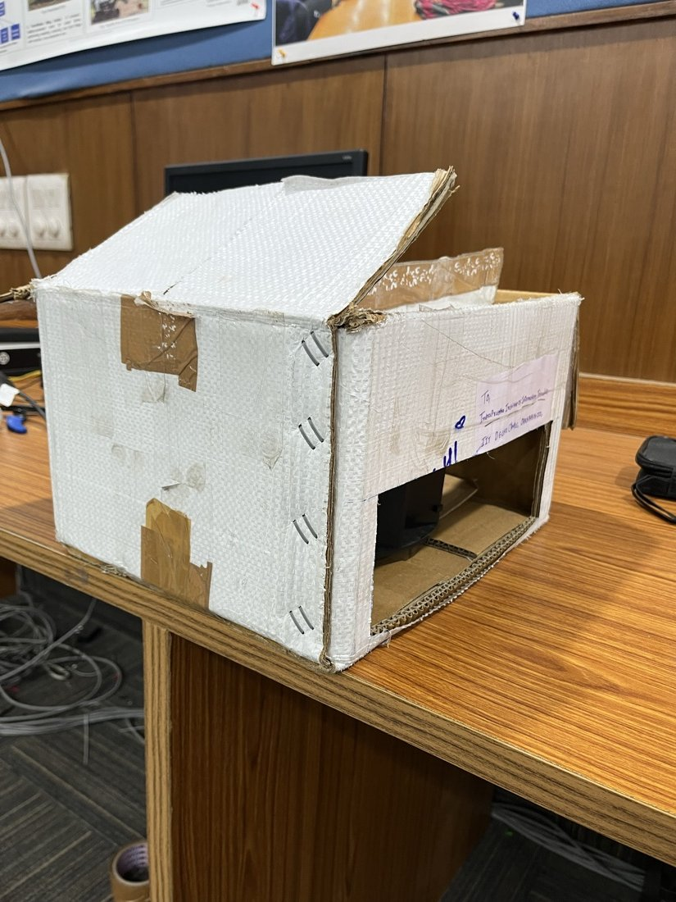
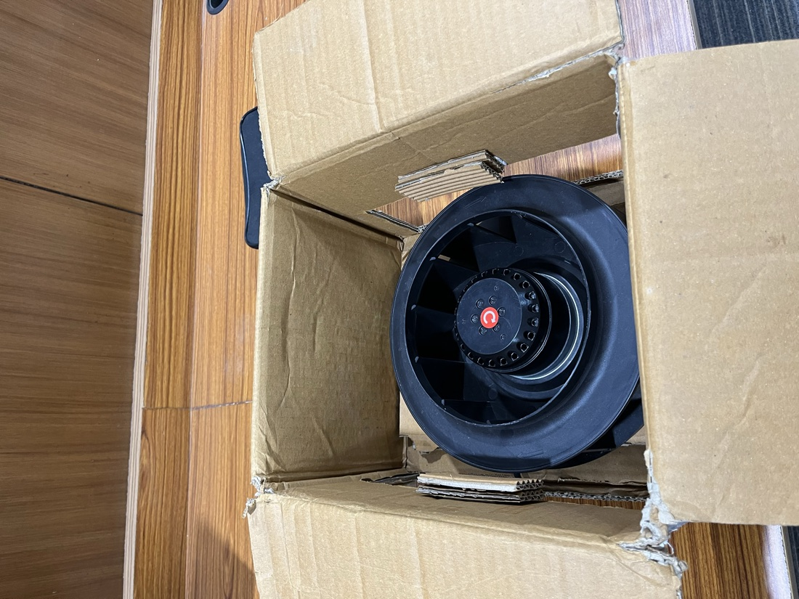
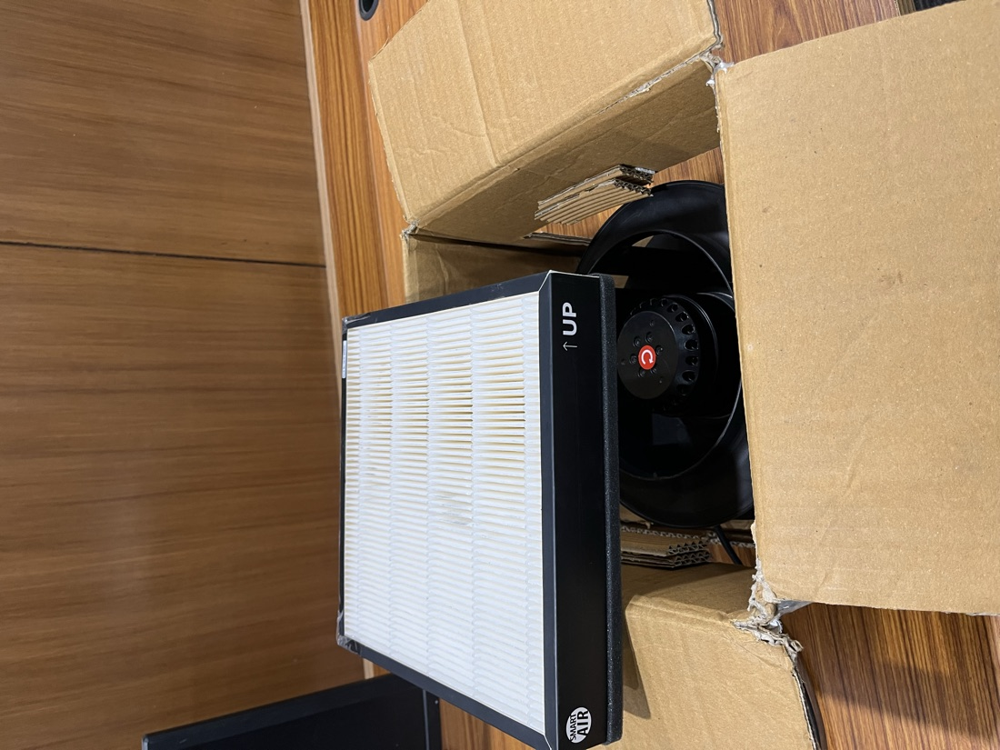
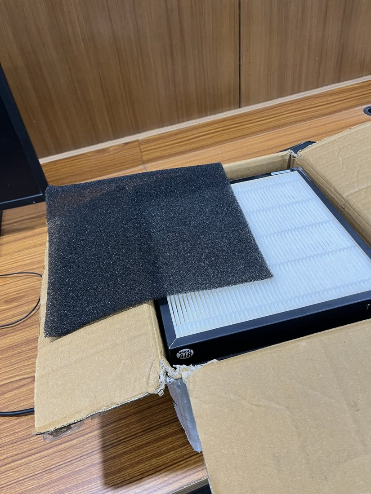
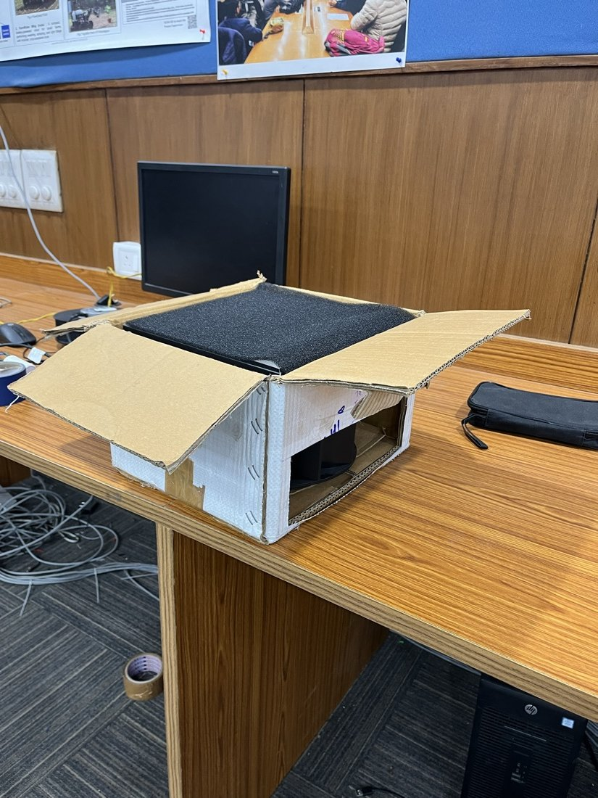

# The air cleaner prototype

A first build of the cleaner: a centrifugal fan that pulls room air through a pleated filter and a foam pre-filter, in a box. It is a prototype, built and measured once. This page says what was built, what was measured, and what the number does and does not mean.

## What was built

| Step | What                                                                                             | Photo                                                               |
| ---- | ------------------------------------------------------------------------------------------------ | ------------------------------------------------------------------- |
| 1    | A box with an opening for the fan's outlet                                                       |                          |
| 2    | A Hicool BCF-250 backward-curved centrifugal fan (230 V, 190 W per its spec sheet) set inside it |                          |
| 3    | A pleated panel filter (Smart Air) laid on the fan's inlet                                       |  |
| 4    | A foam sheet as a pre-filter, over the filter                                                    |   |
| 5    | The box assembled: foam on top, outlet on the side                                               |    |

The measuring unit (an ESP32-S3 and an SPS30 laser particle sensor) is separate from the cleaner. It watches the room's air; the cleaner does not yet switch on or off by what it reads.

## What it cost

| Part                     | Cost       |
| ------------------------ | ---------- |
| Box                      | free       |
| Fan (Hicool BCF-250)     | ₹3,300     |
| Pleated filter           | ₹1,500     |
| Foam pre-filter          | ₹200       |
| **Total of these parts** | **₹5,000** |

That is the cost of the four parts above. A cable, plug or switch is not itemised here. The filter is the only part that recurs.

## What was measured

Airflow at the cleaner's outlet, with a handheld vane anemometer (HTC): **about 191 cubic feet per minute** (two readings in the video, 191.3 and 191.5; the display also showed 29.4 °C and 63.1 % relative humidity). That is about 325 m³ an hour.

## What the number is not

- It is **airflow**, not CADR. CADR (clean air delivery rate) is airflow multiplied by how much of the particles each pass removes, and it is measured by watching the room's particles fall with the cleaner on against off. That test has **not** been run. No figure here says how fast the cleaner cleans a room.
- It is not a filter-efficiency figure, a noise figure or a power figure. None of those was measured.
- It is one measurement of one prototype. It does not say how the cleaner performs in a room, over time, or with a loaded filter.

## What comes next

Run the smoke-decay test with the measuring unit: raise the room's PM2.5 with incense, let it mix, log how fast it falls with the cleaner off, then on, and fit the decay (the fit rules are in `packages/core/src/cadr.ts`: at least ten samples and R² of 0.95 or better). The room page's "Purifier on" marker is the same test, live. Until then, the honest claim is the airflow reading and nothing more.
