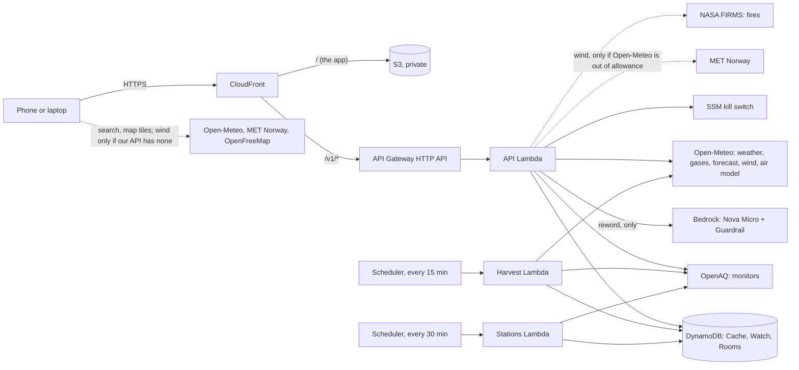

# Architecture

The Vayu Project is one web app and one API, served from one address. The page and the API share a CloudFront address, so the app needs no cross-site settings and a visitor makes one TLS connection.

Live address: https://d3lmq1mze2gup3.cloudfront.net. Stack: `Vayu`, account 534212416249, `ap-south-1`.

## The picture

Dotted lines are calls that do not go through our API. Solid arrows are ours. An animated version for the video is `architecture-animated.html` (open it in a browser).

## What each part does

| Part                       | What it does                                                                                                                                                                                                                                                                | Why                                                                                              |
| -------------------------- | --------------------------------------------------------------------------------------------------------------------------------------------------------------------------------------------------------------------------------------------------------------------------- | ------------------------------------------------------------------------------------------------ |
| **CloudFront**             | Serves the app from S3 (files with a hash in their name are kept a year; the page itself is never kept). Passes `/v1/*` to the API and keeps an answer for as long as the API says, at most 15 minutes. Adds the security headers. Sends the API only the viewer's address. | One address; most repeat requests never reach the API.                                           |
| **S3 bucket**              | Holds the built app. Private, readable only by this CloudFront distribution.                                                                                                                                                                                                | No public bucket.                                                                                |
| **API Gateway (HTTP API)** | Throttles: 25 requests a second, and 3 and 1 a second for the assistant and the form.                                                                                                                                                                                       | A cap on cost and abuse (rule I15).                                                              |
| **API Lambda**             | Every `/v1` route: today, history, stations, fires, replay, rooms, assistant, requests, the alert webhook. Checks every request and answer against a contract.                                                                                                              | One small function; every answer carries where it came from and how old it is (rule I2).         |
| **DynamoDB**               | Cache (the harvest's snapshots and the map monitors, with expiry), Watch (alerts, links, daily quotas), Rooms (device readings). All on demand, with items that expire.                                                                                                     | Nothing to size, nothing to patch.                                                               |
| **Harvest Lambda**         | Every 15 minutes, reads the nearest monitor and the forecast for the four saved places and stores them.                                                                                                                                                                     | A visitor opening the app is usually served from this and the CloudFront cache, not from OpenAQ. |
| **Stations Lambda**        | Every 30 minutes, reads the latest PM2.5 of every monitor in the world (about 7,500 with a reading in the last six hours) from OpenAQ in about ten requests, and keeps them in twelve small items for the map. Stays inside OpenAQ's rate limit.                            | The map never calls OpenAQ.                                                                      |
| **Bedrock**                | Amazon Nova Micro rewords an answer the rules already decided, or answers from the facts given. A guardrail checks the question and the answer.                                                                                                                             | Wording only; see `AGENT-BOUNDARIES.md`.                                                         |
| **SSM Parameter**          | The assistant's kill switch.                                                                                                                                                                                                                                                | Off in one command, no deploy.                                                                   |
| **Secrets Manager**        | The OpenAQ key, the map key, the Telegram token, the webhook secret, the salt for address hashes.                                                                                                                                                                           | No secret in code or settings (rule I14).                                                        |
| **EventBridge Scheduler**  | Starts the harvest and the map monitors. Retries are off so a bad run cannot pile up.                                                                                                                                                                                       | Rule I9.                                                                                         |
| **Step Functions**         | The alert loop (send, wait for a tap, remind, escalate) and "did it work?". Every task has a time limit.                                                                                                                                                                    | Rule I9. Sends are off.                                                                          |
| **CloudWatch, X-Ray**      | One alarm for each thing that can quietly stop (including a schedule that never runs), a dashboard, traces for every function.                                                                                                                                              | A job that never runs reports no error, so it needs its own alarm.                               |
| **CDK (TypeScript)**       | The whole stack, with assertion tests.                                                                                                                                                                                                                                      | `make synth` and `make test` check the caps and permissions.                                     |

## The data, and what is not ours

| Data                                | From                                                                                                                  | Used for                                                              |
| ----------------------------------- | --------------------------------------------------------------------------------------------------------------------- | --------------------------------------------------------------------- |
| PM2.5 at monitors                   | OpenAQ (through our API)                                                                                              | The reading for a place; the map's monitors                           |
| Air-quality forecast, gases         | Open-Meteo (CAMS)                                                                                                     | The next days; the Estimate where no monitor is near                  |
| Weather                             | Open-Meteo                                                                                                            | Temperature, wind, rain, humidity, UV                                 |
| Wind across the map                 | Open-Meteo (ICON, GFS) through our API (`/v1/wind`, kept three hours); MET Norway when Open-Meteo is out of allowance | The wind streaks on the map; always real, never made up               |
| Air colour where no monitor reports | Open-Meteo CAMS through our API (`/v1/airgrid`, kept six hours)                                                       | The map's colour, labelled a model estimate, never drawn as a monitor |
| Fires                               | NASA FIRMS (through our API)                                                                                          | Stubble-burning alerts and the fire count                             |
| Map tiles                           | OpenFreeMap                                                                                                           | The map                                                               |
| Place names                         | Open-Meteo geocoding                                                                                                  | Search (the browser sends only the name typed)                        |

The app labels each number as **Live** (a named monitor, its distance and its age), **Estimate** (the regional model) or **Measured** (the person's own unit). Data older than six hours from a monitor is dropped, and nothing is advised from it.

## Two paths that do not go through AWS

- **The measuring unit.** An ESP32-S3 with an SPS30 sends a packet every two seconds over Bluetooth Low Energy straight to the
  page (Web Bluetooth). The page keeps hourly means on the device; nothing is sent to our API. The IoT, Firehose and Athena
  parts in `infra/` are built for sending device readings to AWS and are not used by this unit. See `UNIT.md`.
- **The recorded days (`/#/week`).** The page loads a 235 KB file of seven real days made by `scripts/record-week.mjs` from the
  OpenAQ and Open-Meteo archives and NASA FIRMS, and plays the app on it. It asks our API for no air, wind or fires; it still
  uses the real assistant and voice. See `AS-BUILT.md`.

## Well-Architected, honestly

| Pillar                     | What is done                                                                                                                                                                                                                                                                                                                                                                                                     | What is not                                                                                                                 |
| -------------------------- | ---------------------------------------------------------------------------------------------------------------------------------------------------------------------------------------------------------------------------------------------------------------------------------------------------------------------------------------------------------------------------------------------------------------- | --------------------------------------------------------------------------------------------------------------------------- |
| **Operational excellence** | One stack in code; `make prove` before every commit; `make smoke` against the live address; alarms for silent failures; a live checklist.                                                                                                                                                                                                                                                                        | No runbook for an outage beyond the kill switches and the checklist.                                                        |
| **Security**               | Private bucket with origin access control; HTTPS only; HSTS, strict content policy, no framing; least-privilege roles (the API may call one model and one guardrail, the stations job may write one table and read one secret); secrets in Secrets Manager with scanning in CI; visitor addresses are only hashed with a daily value and a secret salt; every request body is checked against a strict contract. | No WAF, so no per-address rate limit at the edge. No login: nothing in the app is personal beyond what stays on the device. |
| **Reliability**            | The app keeps the last good reading and says how old it is; a failed monitor lookup falls back to the regional model and says so; the assistant falls back to fixed rules; every job and every wait has a time limit; schedules do not retry.                                                                                                                                                                    | One region. No failover. The map's monitors depend on a single provider's rate limit.                                       |
| **Performance efficiency** | CloudFront caches answers and the app's files; the API does one read from the cache for the saved places; the scheduled jobs, not visitors, call providers.                                                                                                                                                                                                                                                      | The app's main script is 1.7 MB (480 KB compressed) and is not split.                                                       |
| **Cost optimisation**      | Serverless and on demand, so idle cost is about $4.50 a month; a limit on every metered thing; priced per unit in `cost.md`.                                                                                                                                                                                                                                                                                     | Not capped: a flood against CloudFront itself (see `cost.md`).                                                              |
| **Sustainability**         | Nothing runs when nobody asks, other than two short scheduled jobs; answers are cached rather than recomputed.                                                                                                                                                                                                                                                                                                   | Not measured.                                                                                                               |

## Where things are in the code

| Path                 | What                                                                                                                                                                                                                |
| -------------------- | ------------------------------------------------------------------------------------------------------------------------------------------------------------------------------------------------------------------- |
| `apps/web`           | The app (React, MapLibre). `src/air` is where real data enters; `src/week` is the recorded days; `src/devices` is the measuring unit. |
| `apps/api`           | The API Lambda, the stations Lambda and the routes.                                                                                                                                                                 |
| `packages/contracts` | The shape of every request and answer (zod).                                                                                                                                                                        |
| `packages/core`      | The rules: air bands, timeline, windows, verdicts, the assistant's fixed answers. No network, no clock.                                                                                                             |
| `packages/data`      | Clients for OpenAQ, Open-Meteo and FIRMS, and the cache.                                                                                                                                                            |
| `packages/watch`     | The alert loop, Telegram, Bedrock wording, the number check.                                                                                                                                                        |
| `infra`              | The CDK stack and its tests.                                                                                                                                                                                        |
| `firmware/vayu-unit` | The ESP32-S3 sketch for the measuring unit.                                                                                                                                                                         |
| `tests/smoke`        | The live check.                                                                                                                                                                                                     |
| `scripts`            | Build, deploy and check scripts.                                                                                                                                                                                    |
