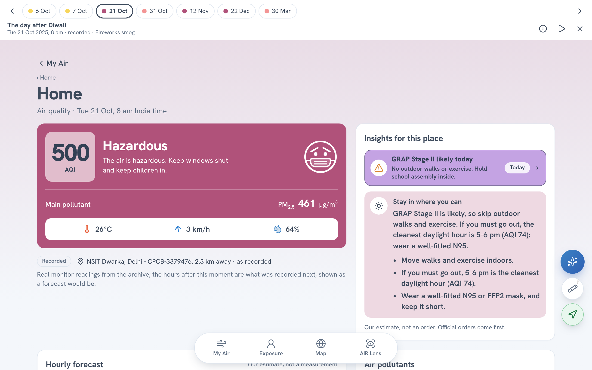
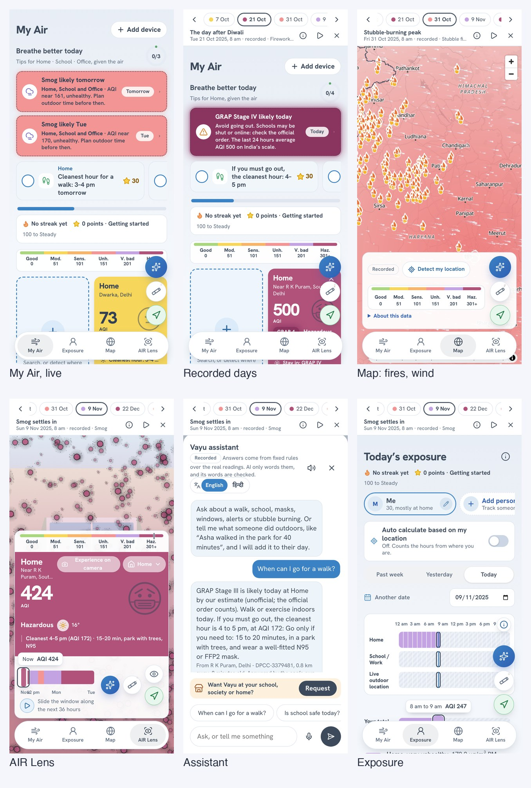
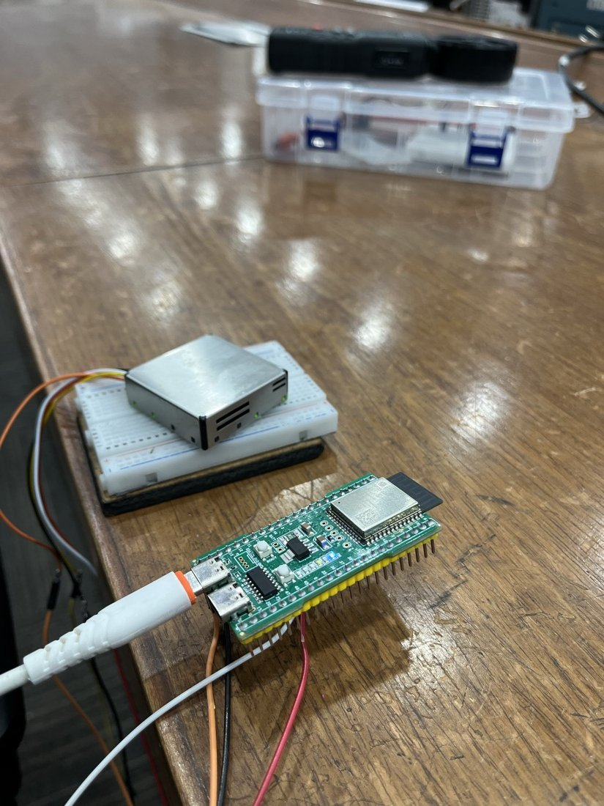
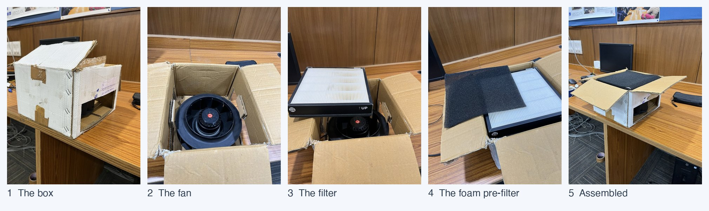
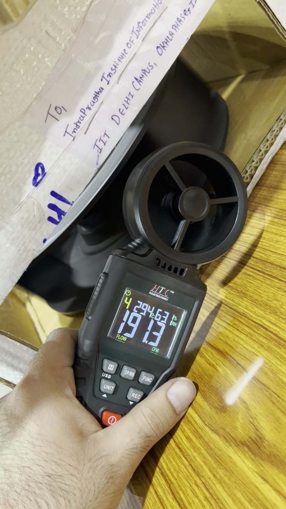

# The morning after Diwali: one clear answer for Delhi's air, built on AWS

Picture a parent in South Delhi at 8 am on 21 October 2025, the morning after Diwali. The phone shows one city-wide Air Quality Index (AQI) figure. The child's bag is by the door. The question is small: do we walk to school, or not?

The parent is made up; the morning is real. The nearest monitor with a fresh reading that day, Lodhi Road, 3.8 km from the spot I had set as "Home" (near R K Puram), read 500, the top of the US AQI scale the card uses, with PM2.5 (fine particles) at 980 µg/m³. On India's scale the last 24 hours at this monitor also averaged 500. The official stage that morning was II, set once for all of Delhi-NCR from the city's 24-hour average of 351; this one monitor was far above the city, so the band for this place's air was IV. The app shows the band beside the official order and never instead of it. The app added what to do: stay in where you can, and if you must go out, 4 to 5 pm is the cleanest daylight hour, at AQI 134 (on a recorded day that is known in hindsight; live, it is a forecast).

_The recorded morning after Diwali, 21 Oct 2025, 8 am. The card names the monitor (Lodhi Road, 3.8 km away) and says "as recorded". The alert row, "Air here is in the GRAP Stage IV band today", is my estimate from the last 24 hours at this monitor, an average AQI of 500 on India's scale (GRAP is Delhi's Graded Response Action Plan, the official pollution stages), and the card adds that official orders come first._

Delhi has plenty of air-quality numbers. A city figure cannot see one street or one room, and none says what to do. The Vayu Project gives one answer for one place, with the monitor's name, its distance and the age of the reading beside it. It is free, opens now, and needs no account to look around (**Try without login** plays seven real days): https://d3lmq1mze2gup3.cloudfront.net.

## What it is

You add the places you care about: Home, a school, an office, a park. Each card shows the air from the nearest monitor with a fresh reading (its name, distance and age), the weather, and what to do about it.

Around My Air are a map of monitors, wind and satellite fires, AIR Lens (the air drawn as particles in front of your camera), an assistant, and Exposure, which adds up what a person breathed, hour by hour.

_The six screens. Top row: My Air on live data with four places set; the recorded days on 21 Oct 2025, where the alert is GRAP Stage IV, the app's estimate from the last 24 hours; the map on 31 Oct 2025 with NASA satellite fire detections and wind. Bottom row: AIR Lens; the assistant; Exposure. All but My Air on live data are from the recorded days._

A small measuring unit, an ESP32-S3 board with a Sensirion SPS30 laser particle sensor, adds the air in one room over Bluetooth.

I built it solo, with Claude as a coding assistant for much of the typing. I chose what it should do and what it must never claim, and I read, ran and tested every change. I wired, flashed and tested the unit and built the cleaner myself. The stack runs in my own AWS account.

## The one rule: code decides, AI only words

The app has an assistant you can ask, in English or Hindi, "When can I go for a walk?" Fixed rules decide the answer from the readings. Amazon Bedrock (Amazon Nova Micro, behind a guardrail) may reword it, or answer a question no rule covers from the facts it is given, and then every number in the wording is compared with the facts. If one is missing from them, the rules' own plain wording goes out instead. When the model is off, slow, or at its daily limit, the rules answer alone and say so. A Hindi answer never reaches the model: it is wording a person wrote, with the facts slotted in. The model has no tools and cannot act.

[`docs/safety.md`](safety.md) lists each rule, where the code enforces it, and the test that fails if it breaks. A monitor reading older than six hours is dropped, and with none left the answer is labelled an Estimate from a regional model, with no advice. A GRAP stage is my estimate from the last 24 hours, and the official order comes first. The app says a school is "likely" closed and points to the school's notice, and it gives no medical advice.

## It is all real data

The deployed app has no made-up data. A prototype build with invented days lives in the repo and is never uploaded, and `make prove` checks the bundle for it. The live app reads real monitors (OpenAQ), weather, forecast and wind (Open-Meteo, with MET Norway as a second wind source) and satellite fires (NASA FIRMS), through my own API on AWS. So that you can see every feature without waiting for a bad day, the app also replays seven recorded days (https://d3lmq1mze2gup3.cloudfront.net/#/week, which a button on My Air opens in a new tab): rain in early October, the morning after Diwali, stubble fires, November and December smog, a January downpour and a windy March day, each played as if it were today at 8 am. Every screen says "recorded". The air comes from four Delhi monitors in OpenAQ's public archive, and the weather and fires are archives too.

The archive had mess in it, so I cleaned it with two written rules. The first drops a PM2.5 of 999 or more (the feed's "out of range"), a PM10 of 2,000 or more, and a PM10 below the same hour's PM2.5, which real air cannot give. The second drops a monitor's hour when it reads over three times the median of at least two others and is itself high (PM2.5 over 200, PM10 over 500). The file counts what the second rule removed: 86 lone spikes across the seven days. I changed nothing else. In the recorded days the map's wind is one recorded wind for central Delhi, drawn the same everywhere, and the map says so.

## The unit, and where it stops

The ESP32-S3 reads the SPS30 over a serial wire and sends an 18-byte packet every two seconds over Bluetooth. The web app connects with Web Bluetooth and shows your room as the first card on My Air, added from the "Add device" button. Open it and the room's air is drawn against the air outside as two lines, so the gap shows what a closed window or a purifier is doing. The hours the unit measured count in Exposure, and an hour without enough readings stays a labelled assumption.

_The measuring unit on my desk: the ESP32-S3 board in front, with a USB cable plugged in, wired by jumper wires to the SPS30 particle sensor on a breadboard._

I have not compared the unit with a monitor, so I do not call it accurate. Bluetooth works in Chrome on a Mac; Android Chrome is untried and iPhone Safari cannot do it. Telegram alerts are built and tested against fakes, but live sends are off. [`docs/claims.md`](claims.md) lists what I say and what I refuse to say.

## I built a cleaner too

The room page can mark the moment a purifier goes on and say how fast the room's PM2.5 fell. That needs a purifier, so I built a prototype: a box, a Hicool BCF-250 backward-curved centrifugal fan inside it, a pleated Smart Air filter laid over the fan's inlet, and a sheet of foam over the filter as a pre-filter. The parts cost ₹5,000: the box was free, the fan ₹3,300, the filter ₹1,500, the foam ₹200.

_The cleaner in five steps: 1 the box, 2 the fan inside it, 3 the pleated filter laid on the fan, 4 the foam laid over the filter, 5 assembled, with the foam on top and the fan's outlet in the side of the box._

A handheld vane anemometer at the outlet read about 191 cubic feet per minute, about 325 m³ an hour (two readings in my video: 191.3 and 191.5, at 29.4 °C and 63.1 % humidity).

_A 5-second video (click the picture to play it): a handheld vane anemometer at the cleaner's outlet, reading about 191 CFM at 29.4 °C and 63.1 % RH. Airflow, not CADR._

CADR (clean air delivery rate), the number purifiers are rated by, also depends on how many particles each pass removes, and it is measured by watching a room's particles fall with the cleaner off and then on. I have not run that test, and I have not measured the filter's efficiency, the noise or the power. Nothing switches it on automatically: the unit's readings do not control it.

## Why each AWS service is there

Everything is one CDK app, in Mumbai (`ap-south-1`) except one call: Nova Micro is reached through an Asia Pacific inference profile, so the model may run in another Asia Pacific region. The AWS open source I used is the CDK and Powertools for AWS Lambda (Logger and Tracer).

| Service                               | Why it is there                                                                                                                                                     |
| ------------------------------------- | ------------------------------------------------------------------------------------------------------------------------------------------------------------------- |
| CloudFront and S3                     | One address for the page and the API, a private bucket                                                                                                              |
| API Gateway and Lambda                | Every route checks its request and answer against a contract                                                                                                        |
| DynamoDB                              | The cache the scheduled jobs fill, the quotas, items that expire                                                                                                    |
| EventBridge Scheduler                 | A 15-minute job keeps four reference places warm and a 30-minute job fills the map's monitors; for other places the API fetches on request and CloudFront caches it |
| Bedrock with a guardrail, and Polly   | Bedrock rewords an answer the rules decided and never decides; Polly reads it aloud                                                                                 |
| Step Functions                        | The alert loop waits for a tap, reminds, escalates; built and tested, live sends switched off                                                                       |
| Cognito and an API Gateway authorizer | Optional accounts: email and password, a saved copy of your places per person, checked by token                                                                     |
| Secrets Manager and SSM               | No key in code; one command switches the assistant off                                                                                                              |
| CloudWatch and X-Ray                  | An alarm for each thing that can stop, and traces                                                                                                                   |

Visitors' browsers still call Open-Meteo to search for a place by name (it sends only the name typed) and OpenFreeMap for map tiles. An IoT Core, Firehose and Athena path is built, but the unit talks straight to the phone.

## What fought back

### My own screenshot said AQI 500 beside "GRAP Stage II"

Writing this post, I looked hard at my own screenshot of the morning after Diwali: AQI 500, and a "GRAP Stage II" alert. Those two do not go together. The estimate averaged the last 24 hours the monitor _had_, so gaps pulled in older, cleaner hours, and it stretched one hour's PM10 to PM2.5 ratio, however large, over the whole day. Now it uses the last 24 hours only (16 must be there), caps that ratio at 2, and treats a missing PM10 as a floor. I checked it against the monitors' own PM10 on 24 station-days: 22 landed in the same stage as the monitor's own index and 2 had no estimate (too few recent hours). The same audit turned up a rain alert that promised clean air when the forecast showed none, and an assistant sheet on a phone that left the answer 236 pixels of room. A second pass, a script driving the live site in a browser, found a model-worded answer that read "[Place] has good air quality" at AQI 61: the model had capitalised my masked-name placeholder, so it was not put back, and it had called a Moderate level good. Placeholders are now restored in any case, and an answer that calls the air good or clean when the level is not Good is refused.

### The model never answered

My first live question came back with no "Wording by AI" label. The guardrail's prompt-attack filter was blocking my own rewording instruction because it sat in the user turn. I moved it to the system prompt, and the model answers.

### A name counted as a number

My number check let `[person 1]` through as the allowed figure 1. The guardrail masks names, and my check read the masked tag as a digit. A masked name no longer counts, and a test holds it.

### The wind ran out

The map's wind stopped, then came back patchy. Open-Meteo counts each point of a many-point request as a call against the address's daily allowance, and a map has hundreds of points. The API now asks once for everyone, keeps the answer, and falls back to MET Norway.

### The unit went quiet the moment the app connected

The serial log showed good readings, then "No more data in frame" as soon as Bluetooth connected. The sensor had stopped measuring, most likely from a power dip. The firmware now restarts the sensor on connect, and after three failed reads in a row.

Other fixes are in [`docs/learning-log.md`](learning-log.md).

## Numbers

- 1,313 tests pass in one command, `make prove`, which also runs lint, types, `cdk synth`, and a check that the deployed bundle holds no prototype code.
- The stack costs about $4.50 a month idle, at list prices. An assistant question costs about $0.0008 (almost all of it the guardrail), and a visit at most $0.00014.
- Caps: 40 assistant questions per caller and 500 a day, 12,000 spoken characters per caller and 60,000 a day, 25 API requests a second. One parameter switches the assistant off.

One cost is not capped: a flood against CloudFront itself. The stack makes its own budget only when given an email address, and I deployed without one; the two $50 budgets in my account were made by hand, and budgets only send email, they stop nothing. [`docs/cost.md`](cost.md) has the arithmetic.

## What I learned

- Keep the model's job small. The model words; code decides and checks. Every failure I had with it (a guardrail that blocked my own instruction, a masked name read as a number) was a place where that line was not tight enough.
- Read your own screenshots as a stranger would. A number can be right and the sentence beside it wrong.
- Real AWS finds what tests do not: a Host header, a rollback that failed, a schedule that stops without an error.
- Price a thing before you cap it. The guardrail was 98% of a question's cost, so that is where the caps went.
- Say what you did not measure. It changed what I put in front of people.

## What is next

Next is the smoke-decay test with the unit beside the cleaner: raise the room's PM2.5 with incense, log how fast it falls with the cleaner off, then on, and fit the decay. The room page's "Purifier on" marker is that same test, live. After that, I will put the unit beside a monitor for a few days and publish the difference. Later come Telegram alerts with a screen to link a chat, and the unit's readings sent to my API so a school can see many rooms.

Code: https://github.com/hrsh-kr/the-vayu-project
