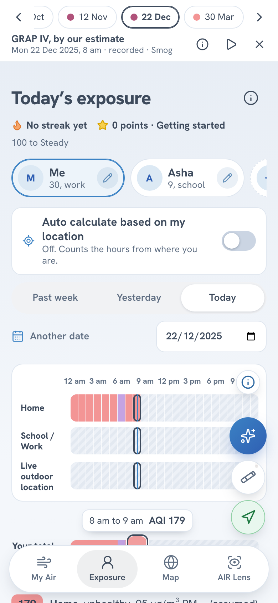
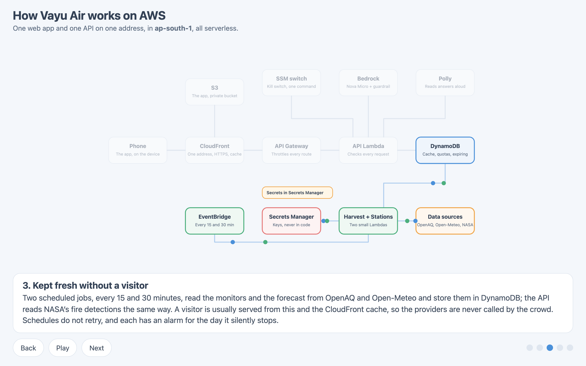

# The morning after Diwali: building one clear answer for Delhi's air on AWS

Picture a parent in Dwarka at 8 am on 21 October 2025, the morning after Diwali. The phone shows a city-wide AQI. The windows are grey. The child's bag is by the door. The question is small: do we walk to school, or not?

The parent is a picture I use to keep the app honest. The morning is real. The nearest monitor that day, NSIT Dwarka, 2.3 km from the place I had set as "Home", read an AQI of 500 with PM2.5 at 461 µg/m³. Delhi has plenty of air-quality numbers. What it lacks is the step after the number: what should this person do, here, now, and how far can they trust it?

*The recorded morning after Diwali, 21 Oct 2025, 8 am. The card names the monitor (NSIT Dwarka, 2.3 km away), says "as recorded", and turns the reading into advice. The stage in the pill is our estimate, and the page says the official order comes first.*

I built Vayu Air to answer that question. I built it alone, with an AI coding assistant (Claude Code). I decided what it should do and what it must never claim, and the assistant wrote most of the code under my direction. I read it, ran it, and sent it back when it was wrong. I wired and tested the small hardware unit myself. The stack runs in my own AWS account.

## What it is, and what it is not

Vayu Air is a free web app. You add the places you care about: Home, a school, an office, a park. Each card shows the air now, the weather, the name of the nearest monitor, how far away it is, how old the reading is, and what to do about it. A small measuring unit, an ESP32-S3 with a Sensirion SPS30 laser particle sensor, adds the air in one room over Bluetooth.

*My Air on live data, four places set. Each card says which monitor it used and how long ago it read.*

It is not an official source. A GRAP stage in the app is my estimate from the last 24 hours, and every line that mentions one tells you the official order comes first. It never says a school is closed, only that it is "likely", and it points to the school's notice. It is not a medical tool. And the unit is a low-cost sensor, not a reference instrument.

## The one rule: code decides, AI only words

The app has an assistant. You can ask it "When can I walk today?" in English or Hindi. Fixed rules decide the answer from the readings. Amazon Bedrock (Nova Micro, behind a guardrail) may reword it, and then every number in the wording is compared with the facts the rules produced. If a number is not there, the plain wording goes out instead. A Hindi answer never reaches the model at all. It is wording a person wrote, with the facts slotted in. The model has no tools and cannot act.

I wanted a property I could test. [`docs/safety.md`](safety.md) lists each rule, where the code enforces it, and the test that fails if it breaks. The same stance runs through the data. A monitor reading older than six hours is dropped, and with none left the answer is labelled an Estimate from a regional model, with no advice. Every number carries its source and age, and the smoke test fails a live answer that lacks them.

*The assistant on a recorded day. The small print names the monitor, the distance and the age. It also says "the assistant has reached its limit for now": the daily cap was hit, and the fixed rules answered on their own.*

## It is all real data

There is no demo mode. The live app reads real monitors (OpenAQ), real weather, forecast and wind (Open-Meteo, with MET Norway as a second source for wind) and real satellite fires (NASA FIRMS), through my own API on AWS.

I did not want to wait for a bad day to show every feature, so the app also plays a recorded week. It is seven real days, from a rainy day in October to the smog of December and a windy day in March. Each is played through the same app as if it were today at 8 am. The air comes from four Delhi monitors in OpenAQ's public archive. The weather and fires are archives too. The page says "recorded" on every screen.

The archive had mess in it. Some readings were 999, the feed's "out of range". Some monitors spiked while their neighbours did not. Two written rules drop those, and the file counts what they dropped: 81 readings. I changed nothing else.

*The recorded week, 22 Dec 2025: a GRAP Stage IV alert, labelled "by our estimate". The day chips above jump between the seven days.*

*The map on 31 Oct 2025: NASA fire detections over Punjab and Haryana, the wind, and the colour between monitors. In the recorded week the wind is a single recorded wind for central Delhi, drawn the same everywhere, and the map says so.*

## The unit, and where it stops

The ESP32-S3 reads the SPS30 over UART and sends an 18-byte packet every two seconds over Bluetooth Low Energy. The web app connects with Web Bluetooth, in Chrome on a computer. It then shows your room as a card, first after "Add a place". Open it and the room's air is drawn against the air outside as two lines, so the gap shows what a closed window or a purifier is doing. The hours the unit measured count in Exposure in place of the outside reading at that address. An hour without enough readings stays a labelled assumption.

*Exposure: the day hour by hour for each person's places. Hours not yet reached are hatched. Hours the unit measured would count here as "measured by your unit".*

<!-- PHOTO NEEDED: the ESP32-S3 board with the SPS30 sensor on my desk, with the serial monitor open if possible, showing the sensor's serial number and PM readings. -->

<!-- PHOTO NEEDED: the room page with the real unit connected (Chrome on a Mac, about 1280 px wide): the live chart with the room's line and the dashed outside line, and the numbers on the right. -->

Here is what I have not done. I have not put the unit beside a monitor for days, so I do not know how it compares, and I do not call it accurate. I have tested Bluetooth in Chrome on a Mac. Android Chrome is untried, and iPhone Safari cannot do it. The air purifier is not built. Its card is a sample with a "To be implemented" banner. Telegram alerts are built and tested against fakes, but live sends are off. [`docs/claims.md`](claims.md) lists what I say and what I refuse to say, and why.

## Why each AWS service is there

Everything is one CDK app in TypeScript. CDK is the only AWS open source tool I used. Region is Mumbai, `ap-south-1`.

| Service | Why it is there |
| --- | --- |
| CloudFront and S3 | One address for the page and the API, a private bucket, security headers |
| API Gateway (HTTP API) and Lambda | Every route checks its request and its answer against a contract |
| DynamoDB | The cache the scheduled jobs fill, the quotas, and the requests, with items that expire |
| EventBridge Scheduler | The monitor harvest (every 15 minutes) and the map's monitors (every 30) run on a clock, so visitors never call a provider |
| Bedrock with a guardrail, and Polly | Wording and voice, never decisions |
| Step Functions | The alert loop waits for a tap, reminds, escalates, with a time limit on every task |
| Secrets Manager and an SSM parameter | No key in code, and one command switches the assistant off |
| CloudWatch and X-Ray | An alarm for each thing that can quietly stop, and traces |

I also built an IoT Core, Firehose and Athena path, but the unit does not use it. It talks straight to the phone.

*Scene 3 of the animated diagram in the repo. Two scheduled jobs read the providers and store the answers, so the crowd never calls OpenAQ.*

## What fought back

I found each of these by running the system.

### The model never answered

My first live question came back with no "Wording by AI" label. The Bedrock guardrail has a prompt-attack filter, and it was blocking my own rewording instruction because the instruction sat in the user turn. I moved it to the system prompt and it passed. A guardrail applies to your own instructions too.

### A name counted as a number

My number check let `[person 1]` through as the allowed figure 1. The guardrail masks names, and my check read the masked tag as a digit. A masked name no longer counts, and a test holds it. A check that looks at digits needs to know what else produces them.

### The wind ran out

The map's wind stopped, then came back patchy. Open-Meteo counts each point of a many-point request as a call against the address's daily allowance, and a map has hundreds of points. The API now asks once for everyone, keeps the answer, falls back to MET Norway, and retries no sooner than ten minutes after a refusal. The visitor's browser should never be the one asking.

### The archive had 999 in it

The recorded week showed absurd spikes for 22 December and 30 March. One monitor read 999 and others spiked alone. I did not hand-edit them. I wrote two rules, dropped the readings, and wrote the count into the file. If you clean data, keep the cleaning short enough to state in one sentence.

### The unit went quiet the moment the app connected

The serial log showed good readings, then "No more data in frame" as soon as Bluetooth connected. The sensor had stopped measuring, most likely from a power dip. The firmware now starts the sensor again on connect, and after three failed reads in a row. Before that, the first firmware had assumed I2C on an ESP32 DevKit, and my board is an ESP32-S3 wired over UART. I caught it by reading the board's own sketch, and it was rewritten for the real wiring.

Smaller ones: CloudFront forwarded the viewer's `Host` header and API Gateway answered 403. My first `cdk deploy` failed, and its rollback failed too, because an API stage setting named a route before the route existed. OpenAQ rejected my key with a 401 late on 10 October, and I put a new one in Secrets Manager. The whole list is in [`docs/learning-log.md`](learning-log.md).

## Numbers

- 1,243 tests pass in one command, `make prove`, which also runs lint, types, `cdk synth`, and a check that the deployed bundle holds no prototype code.
- The stack costs about $4.50 a month idle, at list prices, before any free tier.
- An assistant question costs about $0.0008. A visit costs at most $0.00014.
- Caps: 40 assistant questions per caller and 500 a day, 12,000 spoken characters per caller and 60,000 a day, and 25 API requests a second. The assistant can be switched off with one parameter.
- The stations job read 7,268 monitors.

One cost is not capped: a flood against CloudFront itself. The budgets email me at $50 a month. They do not stop anything. [`docs/cost.md`](cost.md) has the prices and the arithmetic.

## What is next

Put the unit beside a monitor for a few days and publish the difference, good or bad. Build the purifier and measure its air-delivery rate rather than quote one. Turn on scheduled Telegram alerts and add a screen to link a chat. Move the unit's readings to my API, so a school can see many rooms.

Live: https://d3lmq1mze2gup3.cloudfront.net
The recorded week: https://d3lmq1mze2gup3.cloudfront.net/#/week
Code: https://github.com/hrsh-kr/vayu-air
