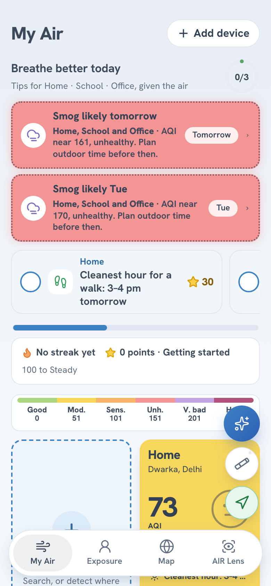
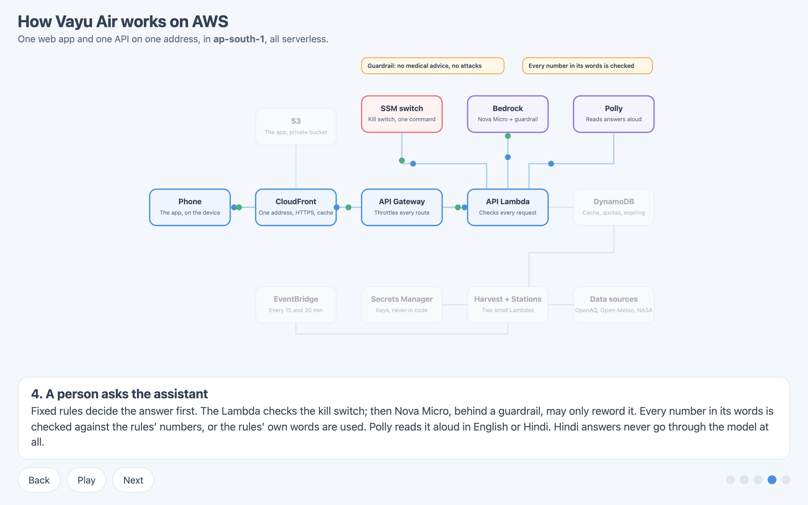
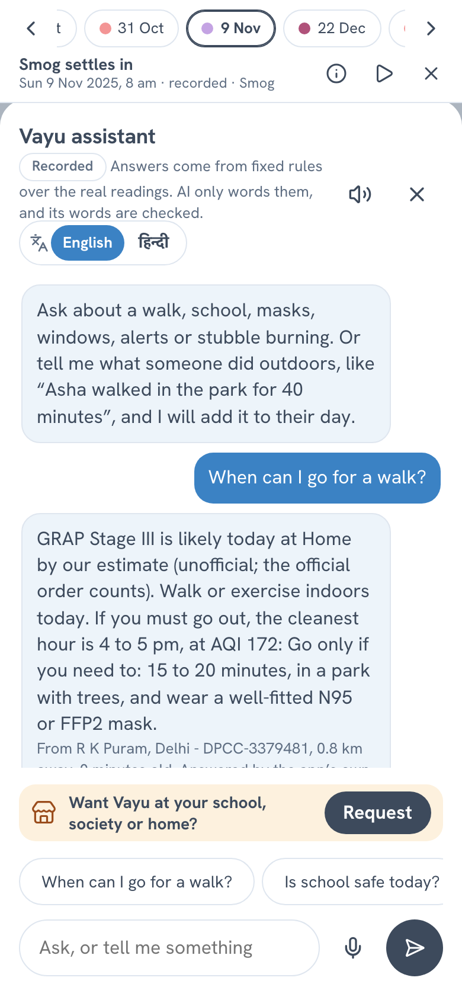
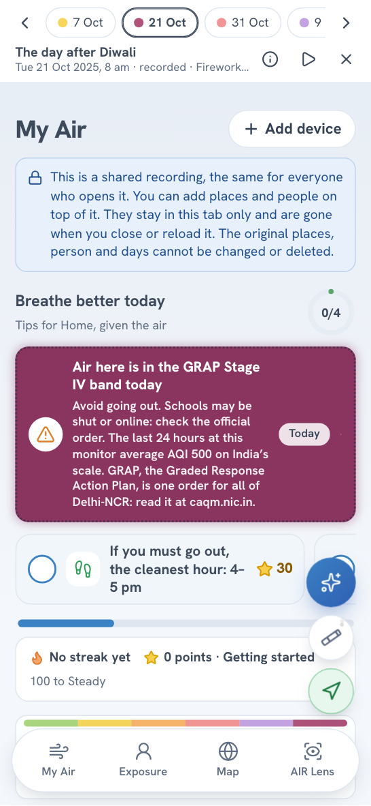
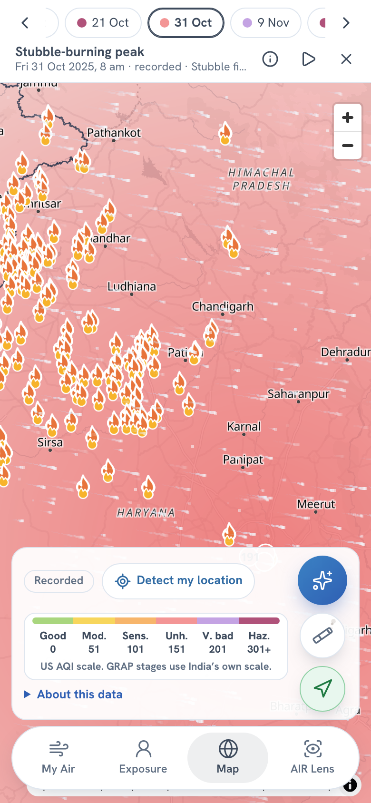

# The morning after Diwali: one clear answer for Delhi's air, built on AWS

Delhi has plenty of air-quality numbers. A city figure cannot see one street or one room, and no number says what to do. Vayu Air gives one answer for one place, with the monitor's name, its distance and the age of the reading beside it. It is free, it has no sign-up, and you can open it now: https://d3lmq1mze2gup3.cloudfront.net. You type a place name, or tap "Detect my location", and the card for that place is there.

Picture a parent in Dwarka at 8 am on 21 October 2025, the morning after Diwali. The phone shows one city-wide Air Quality Index (AQI) figure. The child's bag is by the door. The question is small: do we walk to school, or not? A city figure cannot answer it. The monitor 2.3 km from Home can.

The parent is a picture I use to keep the app honest. The morning is real. The nearest monitor that day, NSIT Dwarka, 2.3 km from the place I had set as "Home", read an AQI of 500, the top of the scale, with PM2.5 (the fine particles that reach deep into lungs) at 461 µg/m³. The app added what to do: stay in where you can, and if you must go out, 5 to 6 pm is the cleanest daylight hour, at AQI 74.

_The recorded morning after Diwali, 21 Oct 2025, 8 am. The card names the monitor (NSIT Dwarka, 2.3 km away) and says "as recorded". The alert row, "GRAP Stage II likely today", is our estimate (GRAP is Delhi's Graded Response Action Plan, the official pollution stages), and the footer says "Our estimate, not an order. Official orders come first."_

## What it is

You add the places you care about: Home, a school, an office, a park. Each card shows the air now, the weather, the nearest monitor's name, how far it is, how old its reading is, and what to do about it. A usual dashboard shows the city's number. Vayu Air shows the number from the monitor nearest this place, how old it is, and what to do about it. It also adds up what a person breathed over the day.

_My Air on live data, four places set. Each card names the nearest monitor, its distance and how old its reading is (e.g. "4 km · 1 h ago"); long names are cut short on a narrow screen. "Nearest" means the nearest monitor with a fresh reading, which is why Home in Dwarka showed a monitor in Vasant Kunj on the day I took this._

A small measuring unit, an ESP32-S3 board with a Sensirion SPS30 laser particle sensor, adds the air in one room over Bluetooth. I built the whole thing alone, with an AI coding assistant (Claude Code). I chose what it should do and what it must never claim, and the assistant wrote most of the code from my instructions. I read every change, ran it, and sent it back when it was wrong. I wired, flashed and tested the unit myself, and the stack runs in my own AWS account.

## The one rule: code decides, AI only words

The app has an assistant you can ask, in English or Hindi, "When can I go for a walk?" Fixed rules decide the answer from the readings. Amazon Bedrock (Amazon Nova Micro, behind a guardrail) may reword it, and then every number in the wording is compared with the numbers the rules produced. If one is missing from the facts, the rules' own plain wording goes out instead. A Hindi answer never reaches the model. It is wording a person wrote, with the facts slotted in. The model has no tools and cannot act.

I wanted a property I could test. [`docs/safety.md`](safety.md) lists each rule, where the code enforces it, and the test that fails if it breaks. The data follows the same stance. A monitor reading older than six hours is dropped, and with none left the answer is labelled an Estimate from a regional model, with no advice. Every number carries its source and age, and the smoke test fails a live answer without them.

_Scene 4 of the animated diagram in the repo: the rules decide, the model only rewords behind a guardrail, every number is checked, and Polly reads the answer aloud._

_The fallback in action, on a recorded day. The small print names the monitor (NSIT Dwarka, 2.3 km, 0 minutes old) and says the assistant has reached its limit for now, so the app's own rules answered. They still gave the cleanest hour, 11 am to 12 pm._

## What it does not claim

A GRAP stage in the app is my estimate from the last 24 hours, and the official order comes first. The app says a school is "likely" closed and points to the school's notice. It gives no medical advice. The unit is a low-cost sensor and I have never compared it with a monitor over days, so I do not call it accurate.

## It is all real data

There is no demo mode. The live app reads real monitors (OpenAQ), real weather, forecast and wind (Open-Meteo, with MET Norway as a second source for wind) and real satellite fires (NASA FIRMS), through my own API on AWS.

I did not want to wait for a bad day to show every feature, so the app also plays a recorded week (https://d3lmq1mze2gup3.cloudfront.net/#/week): seven real days, from a rainy day in October to the smog of December and a windy day in March. Each is played through the same app as if it were today at 8 am, and every screen says "recorded". The air comes from four Delhi monitors in OpenAQ's public archive. The weather and fires are archives too.

The archive had mess in it, and I cleaned it with two written rules. The first drops any value of 999 or more (the feed's "out of range"), or a PM10 below the same hour's PM2.5, which cannot happen. The second drops an hour when one monitor reads over three times the median of the others. The recording file counts what the second rule removed: 81 lone spikes across the seven days. I changed nothing else.

_The recorded week, 22 Dec 2025: a GRAP Stage IV alert, labelled "by our estimate". The chips at the top jump between the seven days._

_The map on 31 Oct 2025: NASA fire detections over Punjab and Haryana, the wind, and the colour between monitors. In the recorded week the wind is one recorded wind for central Delhi, drawn the same everywhere, and the map says so._

## The unit, and where it stops

The ESP32-S3 reads the SPS30 over a serial wire and sends an 18-byte packet every two seconds over Bluetooth. The web app connects with Web Bluetooth and shows your room as the first card on My Air, added from the "Add device" button. Open it and the room's air is drawn against the air outside as two lines, so the gap shows what a closed window or a purifier is doing. The hours the unit measured count in Exposure in place of the outside reading at that address. An hour without enough readings stays a labelled assumption.

What I have not done: compared the unit with a monitor for days, so I do not know how well it agrees. Bluetooth works in Chrome on a Mac. Android Chrome is untried, and iPhone Safari cannot do it. The air purifier is not built, and its card is a sample with a "To be implemented" banner. Telegram alerts are built and tested against fakes, but live sends are off. [`docs/claims.md`](claims.md) lists what I say and what I refuse to say.

## Why each AWS service is there

Everything is one CDK app in TypeScript, in Mumbai (`ap-south-1`) except one call: Nova Micro is reached through an Asia Pacific inference profile, so the model may run in another Asia Pacific region. The AWS open source I used is the AWS CDK, and Powertools for AWS Lambda (Logger and Tracer) in the API.

| Service                              | Why it is there                                                                                                                                                           |
| ------------------------------------ | ------------------------------------------------------------------------------------------------------------------------------------------------------------------------- |
| CloudFront and S3                    | One address for the page and the API, a private bucket, security headers                                                                                                  |
| API Gateway (HTTP API) and Lambda    | Every route checks its request and its answer against a contract                                                                                                          |
| DynamoDB                             | The cache the scheduled jobs fill, the quotas and the requests, with items that expire                                                                                    |
| EventBridge Scheduler                | The monitor harvest (every 15 minutes) and the map's monitors (every 30) run on a clock, so visitors never call OpenAQ                                                    |
| Bedrock with a guardrail             | Rewords an answer the rules already decided, never decides. A small model (Nova Micro) is enough for a reword; the guardrail is about 98% of the $0.0008 a question costs |
| Polly                                | Reads answers aloud                                                                                                                                                       |
| Step Functions                       | The alert loop waits for a tap, reminds and escalates; built and tested, live sends switched off                                                                          |
| Secrets Manager and an SSM parameter | No key in code, and one command switches the assistant off                                                                                                                |
| CloudWatch and X-Ray                 | An alarm for each thing that can quietly stop, and traces                                                                                                                 |

Visitors' browsers still call Open-Meteo to search for a place by name (it sends only the name typed) and OpenFreeMap for map tiles. I also built an IoT Core, Firehose and Athena path. The unit does not use it, because it talks straight to the phone.

## What fought back

I found each of these by running the system.

### The model never answered

My first live question came back with no "Wording by AI" label. The Bedrock guardrail has a prompt-attack filter, and it was blocking my own rewording instruction because it sat in the user turn. I moved it to the system prompt, and the model answers.

### A name counted as a number

My number check let `[person 1]` through as the allowed figure 1. The guardrail masks names, and my check read the masked tag as a digit. A masked name no longer counts, and a test holds it.

### The wind ran out

The map's wind stopped, then came back patchy. Open-Meteo counts each point of a many-point request as a call against the address's daily allowance, and a map has hundreds of points. The API now asks once for everyone, keeps the answer, falls back to MET Norway, and retries no sooner than ten minutes after a refusal. Visitors' browsers no longer ask Open-Meteo for wind or air.

### The archive had 999 in it

The recorded week first showed absurd spikes on 22 December and 30 March. The two rules above came from that, and the count of 81 is in the file.

### The unit went quiet the moment the app connected

The serial log showed good readings, then "No more data in frame" as soon as Bluetooth connected. The sensor had stopped measuring, most likely from a power dip. The firmware now starts the sensor again on connect, and after three failed reads in a row. Before that, the first firmware had assumed a different wiring (I2C on an ESP32 DevKit), and my board is an ESP32-S3 wired over serial. I caught it by reading the board's own sketch, and it was rewritten and run.

The whole list is in [`docs/learning-log.md`](learning-log.md).

## Numbers

- 1,243 tests pass in one command, `make prove`, which also runs lint, types, `cdk synth`, and a check that the deployed bundle holds no prototype code.
- The stack costs about $4.50 a month idle, at list prices.
- An assistant question costs about $0.0008. A visit costs at most $0.00014.
- Caps: 40 assistant questions per caller and 500 a day, 12,000 spoken characters per caller and 60,000 a day, 25 API requests a second. One parameter switches the assistant off.
- The stations job read 7,268 monitors.

One cost is not capped: a flood against CloudFront itself. The two $50 budgets in my account were made by hand, and the stack's own budget alert has no address set. Budgets here do not stop anything. [`docs/cost.md`](cost.md) has the prices and the arithmetic.

## What is next

Put the unit beside a monitor for a few days and publish the difference, good or bad. Build the purifier and measure its air-delivery rate rather than quote one. Turn on scheduled Telegram alerts and add a screen to link a chat. Move the unit's readings to my API, so a school can see many rooms.

Code: https://github.com/hrsh-kr/vayu-air
